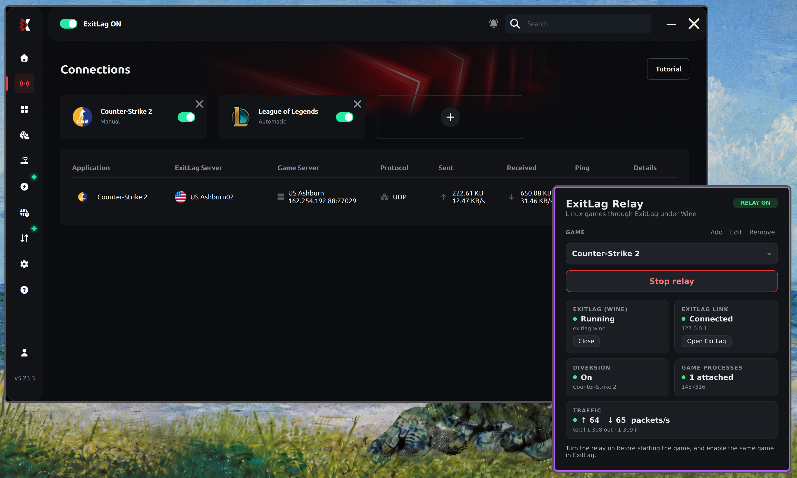

# exitlag-relay



Play games natively on Linux while [ExitLag](https://www.exitlag.com) routes
their traffic. ExitLag only exists for Windows, so it runs under Wine
(GE-Proton through umu), and a small system daemon hands it the game's UDP
packets. The game itself runs natively and isn't modified.

A tray app, **ExitLag Relay**, installs ExitLag into its own Wine prefix,
starts it, and turns the relay on and off per game.

> [!IMPORTANT]
> This project is not affiliated with or endorsed by ExitLag. You need your
> own ExitLag account and subscription. It works by replacing one of
> ExitLag's DLLs inside its Wine prefix, so an ExitLag update can break it,
> and using it may go against ExitLag's terms of service. Use it at your own
> risk.

Tested with Counter-Strike 2 (about 119 ms through ExitLag against 210 ms
direct), ExitLag 5.x and GE-Proton.
Other games that play over UDP should work the same way.

## Requirements

- x86_64 Linux with systemd and cgroup v2 (the default on current
  distributions)
- Linux 5.13 or newer, `nftables` and `iproute2`
- [umu-launcher](https://github.com/Open-Wine-Components/umu-launcher)
  (`umu-run`), which downloads GE-Proton the first time
- Python 3 with PySide6 (the app) and dbus-fast (ExitLag's tray icon), or
  let the installer put both in a private environment with `--venv`
- a desktop with a system tray (StatusNotifierItem): KDE Plasma, GNOME with
  the AppIndicator extension, waybar and most others
- `jq` and `procps`

## Install

### From a release (any systemd distribution) (not tested)

Download the latest `exitlag-relay-*-x86_64-linux.tar.gz` from the
[releases page](https://github.com/murdoockds/exitlag-relay/releases),
then:

```sh
tar xzf exitlag-relay-*-x86_64-linux.tar.gz
cd exitlag-relay-*-x86_64-linux
sudo ./install.sh
```

The installer copies everything to `/usr/local`, sets up the system
service, and then lists anything still missing with the command to install
it on Arch, Fedora, Debian/Ubuntu or openSUSE. If your distribution doesn't
package PySide6 or dbus-fast, run `sudo ./install.sh --venv` instead.

Options: `--user NAME` (the desktop user who runs the app; defaults to the
user who ran sudo), `--prefix DIR` (default `/usr/local`), `--port N`
(default 27999). To remove it: `sudo ./install.sh --uninstall`.

What gets installed:

| Path | What |
| --- | --- |
| `/usr/local/bin/exitlag-relay` | the ExitLag Relay app |
| `/usr/local/bin/exitlag-relayd` | the relay daemon (run by the service) |
| `/usr/local/bin/exitlag-wine` | installs, starts and stops ExitLag under Wine |
| `/usr/local/bin/exitlag-tray` | ExitLag's tray icon as a native tray item |
| `/usr/local/bin/exitlag-run` | optional Steam launch wrapper |
| `/usr/local/share/exitlag-relay/wine/` | the `nfapi.dll` shim and its helpers |
| `/etc/systemd/system/exitlag-relay.service` | the daemon's service (not enabled; the app starts it) |
| `/etc/polkit-1/rules.d/50-exitlag-relay.rules` | lets your user start and stop that one service without a password |
| `/etc/sysctl.d/90-exitlag-relay.conf` | turns off reverse-path filtering on the relay's interface |
| `/etc/modules-load.d/exitlag-relay.conf` | loads `tun` and `nft_socket` at boot |

### From source (not tested)

Needs Go 1.22+ and [zig](https://ziglang.org/download/) (it cross-compiles
the Windows DLL).

```sh
git clone https://github.com/murdoockds/exitlag-relay
cd exitlag-relay
make
sudo ./install.sh
```

### NixOS

```nix
# flake.nix
inputs.exitlag-relay = {
  url = "github:murdoockds/exitlag-relay";
  inputs.nixpkgs.follows = "nixpkgs";
};

# configuration
imports = [ inputs.exitlag-relay.nixosModules.default ];
services.exitlag-relay = {
  enable = true;
  user = "alice";
};
```

| Option | Default | |
| --- | --- | --- |
| `enable` | `false` | Install the app, `exitlag-wine` and the daemon's service. |
| `user` | (required) | Desktop user of the app. Only they (and root) may use the control socket, only their processes are diverted, and they may start and stop the service without a password. |
| `autoStart` | `false` | Start the daemon at boot instead of when the app opens. |
| `listenAddress` | `127.0.0.1` | Address the daemon listens on for the shim. |
| `port` | `27999` | UDP port between the daemon and the shim. |
| `wine.home` | `~user/.local/share/exitlag-wine` | `exitlag-wine`'s state directory and Wine prefix. |

## First run

1. Download ExitLag's Windows installer from exitlag.com.
2. Open **ExitLag Relay** from the app menu. It asks for the installer and
   sets up ExitLag in `~/.local/share/exitlag-wine/prefix`. This takes a few
   minutes the first time, since umu downloads GE-Proton. ExitLag's
   installer reports that it couldn't install the NDIS driver; click OK, the
   relay doesn't use that driver.
3. Pick a game and click **Start relay**. ExitLag opens; sign in once.
4. If ExitLag asks to switch its network discovery from ICMP to TCP ("your
   ISP limits the number of requests"), answer **Yes**. The ISP isn't the
   cause: Wine reports traceroute hops wrongly (see
   [wine/README.md](wine/README.md#not-done--limits)).

The command-line equivalent of step 2 is
`exitlag-wine setup ~/Downloads/SetupExitLag-*.exe`.

## Playing

1. In ExitLag Relay, pick the game and click **Start relay**. This starts
   ExitLag if it isn't running.
2. In ExitLag, select the same game and boost it.
3. Start the game.

Sockets are tagged when they're created, so a game started before the relay
was on keeps going direct until you restart it. The "Game processes" card
shows how many processes were picked up.

For a guaranteed pickup, set the game's Steam launch options to
`exitlag-run %command%`. It registers the game with the daemon before the
game starts, and starts the game normally when the relay isn't running.

Closing the window keeps the app in the tray. Its tray menu has **Exit**,
which turns the relay off, closes ExitLag and stops the service.

### Games

The app comes with Counter-Strike 2, Dota 2, Apex Legends (Proton) and
Discord (Vesktop). Add others with **Add**: a name, the Linux process
name(s), and the Windows `.exe` name ExitLag knows the game by. **Detect
from running game…** lists your programs that have UDP sockets open and
fills the fields in.

| Linux process entry | Matches |
| --- | --- |
| `cs2` | the process name (`comm`) or `argv[0]`'s basename |
| `r5apex.exe` | a Proton, Wine or Bottles game: Wine names the process after the `.exe` |
| `scope:vesktop` | every process of an app started in a systemd scope `app-…vesktop-….scope` (for Electron apps, which are all called `electron`) |
| `cmd:text` | text anywhere in the command line |

Games are saved in `~/.config/exitlag-relay/games.json`.

## How it works

```
game (Linux)  ── its UDP, marked by cgroup (nftables)
     │
     ▼
exitlag0 (TUN) ── exitlag-relayd (system service)
                        │  UDP on 127.0.0.1:27999
                        ▼
      ExitLag.exe under Wine ◄── nfapi.dll shim: reports each game port as a
             │                   socket owned by a stand-in <game>.exe
             ▼
      ExitLag's tunnel ──► ExitLag servers ──► game servers
```

When the relay is on, the daemon moves the game's processes into the
`exitlag-relay` cgroup. An nftables rule marks UDP sent from that cgroup's
sockets and a routing rule sends it into the `exitlag0` TUN device. TCP,
LAN destinations and every other program stay direct.

On the Windows side, ExitLag normally intercepts traffic through NetFilter
SDK (`nfapi.dll` plus a kernel driver Wine can't load). The shim replaces
`nfapi.dll`: it receives the game's packets from the daemon and presents
them to ExitLag as traffic from a process named after the game's `.exe`,
which is how ExitLag recognizes games. [wine/README.md](wine/README.md)
covers the shim and the Wine workarounds it carries.

Traffic is only diverted while a game is selected and the shim is checking
in (every second). If ExitLag closes or the daemon stops, the game goes
direct again within about 5 seconds. `exitlag0` has no IP address and is
down while idle, so other programs (Discord's WebRTC, for one) never see
it as a route.

The daemon needs root for the TUN device, routing and nftables rules, and
for moving processes between cgroups. It isn't started at boot: the app
starts it when it opens and stops it on Exit, which removes all its rules.

## Command line

```sh
exitlag-wine                  # start ExitLag
exitlag-wine stop             # close it
exitlag-wine setup INSTALLER  # install ExitLag into the prefix
exitlag-wine exec PROGRAM     # run something else in the prefix (ExitLag closed)
sudo systemctl stop exitlag-relay   # daemon off, all rules removed
```

`exitlag-wine` reads a few environment variables: `EXITLAG_WINE_HOME`
(state directory), `PROTONPATH` (Proton build for umu, default the latest
GE-Proton), and `QT_SCREEN_SCALE_FACTORS` for HiDPI (see below).

Logs:

- `~/.local/share/exitlag-wine/logs/` (Proton and `exitlag-wine`)
- `~/.local/share/exitlag-wine/prefix/drive_c/Relay/nfshim.log` (the shim)
- `journalctl -u exitlag-relay` (the daemon)

### HiDPI

Wine reports 96 DPI on every monitor, so on a scaled output ExitLag comes
out small. On niri, `exitlag-wine` reads each output's scale and passes it
to Qt automatically. On other desktops, set the scale per monitor by its
model name, for example in the app's environment or your shell profile:

```sh
export QT_SCREEN_SCALE_FACTORS="DELL U2720Q=1.5;LG ULTRAGEAR=1"
```

## Troubleshooting

| Symptom | Cause / fix |
| --- | --- |
| "couldn't start the relay service" | Check `journalctl -u exitlag-relay`. Missing `nft`/`ip`, or a kernel without `nft_socket`, are the usual causes. |
| The game can't reach its servers while the relay is on | Replies are being dropped on `exitlag0`. `sysctl net.ipv4.conf.exitlag0.rp_filter` must be `0`, and a firewall with a strict reverse-path check (`fib saddr . iif oif missing drop`) needs an exception for `exitlag0`. The `IPReversePathFilter` counter in `/proc/net/netstat` grows when the kernel drops them. |
| "ExitLag didn't connect" | ExitLag isn't running or isn't signed in. Check `nfshim.log`. |
| Game processes stay at 0 | The game was started before the relay, or its process name doesn't match the profile. Use **Detect**, or `exitlag-run %command%`. |
| Ping no better than direct | Make sure the game is boosted in ExitLag with a route selected. While the relay is on, `ip route get <server ip> mark 0x6d72` should show `exitlag0`. |
| ExitLag stopped working after it updated itself | The updater restores the original `nfapi.dll`. `exitlag-wine` puts the shim back on every start, so restart ExitLag. If it still fails, open an issue with `nfshim.log`. |
| No ExitLag tray icon | `exitlag-tray` needs dbus-fast and a StatusNotifier tray. Without them ExitLag falls back to Wine's tray item. |

## Development

| Path | What |
| --- | --- |
| `cmd/exitlag-relayd` | the daemon: TUN device, cgroup/nftables diversion, process watcher, control socket |
| `internal/wire` | the daemon ↔ shim protocol |
| `wine/nfshim` | `nfapi.dll` and helpers, built with `zig cc -target x86_64-windows-gnu` |
| `wine/exitlag-wine.sh`, `wine/exitlag-tray.py` | launcher and tray helper |
| `gui/` | the ExitLag Relay app (PySide6) and `exitlag-run` |
| `install.sh`, `dist/`, `Makefile` | install for systemd distributions |
| `flake.nix`, `module.nix`, `*.nix` | Nix packages and NixOS module |

`make` builds into `build/`; `make dist` makes the release tarball. Pushing a
`v*` tag builds the tarball on GitHub Actions and publishes it as a release.

The daemon's control socket is `/run/exitlag-relay/control.sock` (one JSON
object per line: `status`, `set` a game profile, `clear`, `attach` a PID).

## License

MIT. See [LICENSE](LICENSE).
